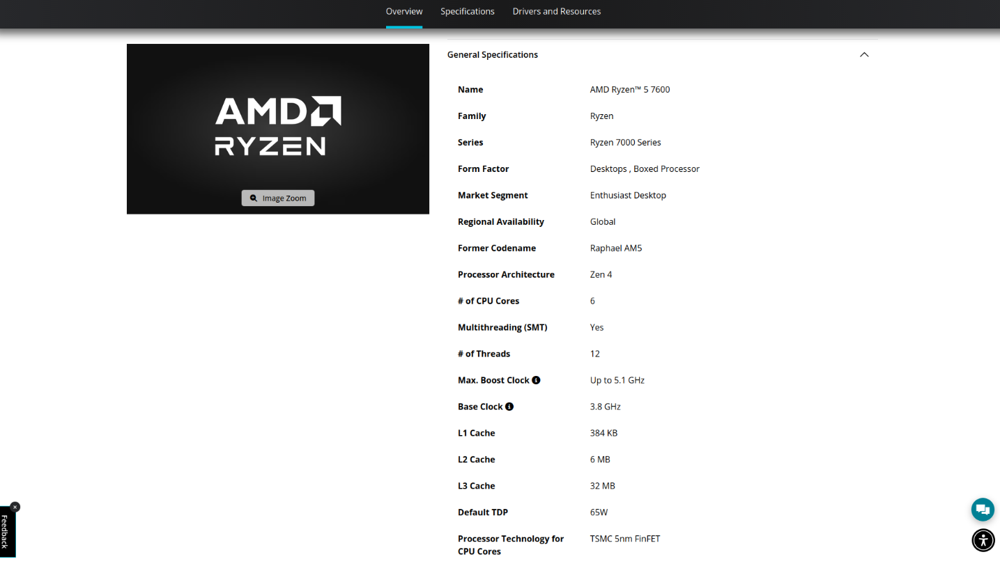
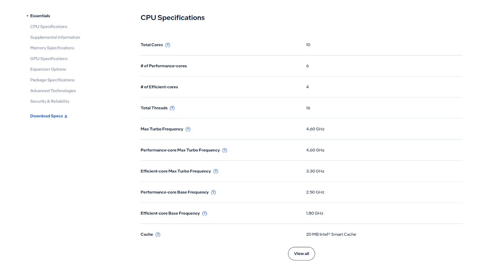
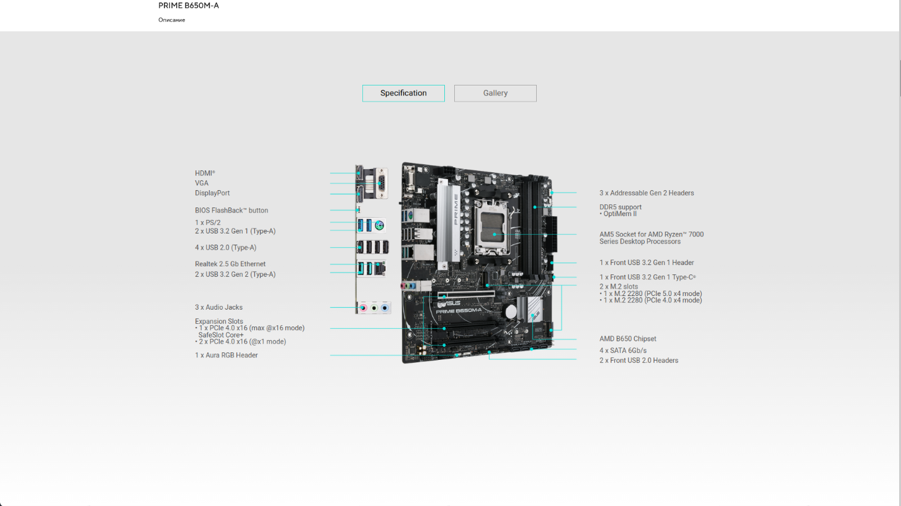
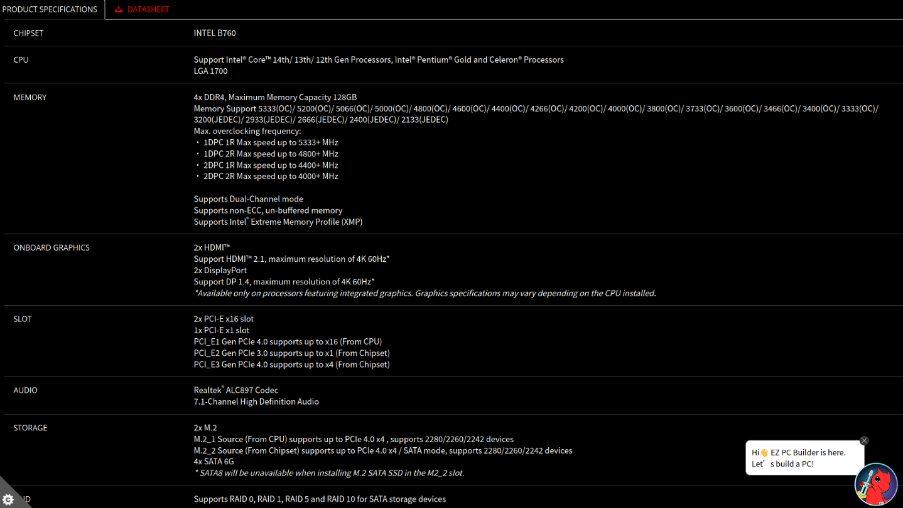
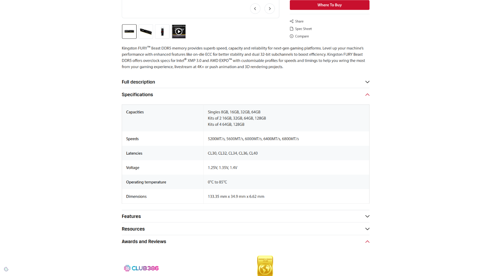
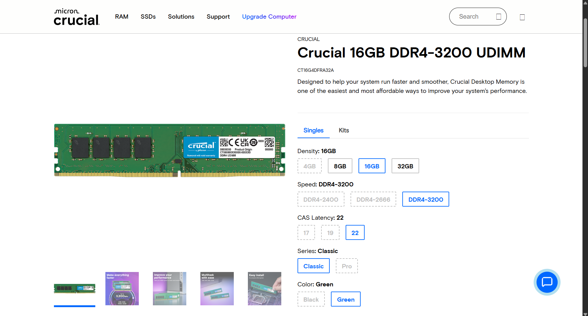
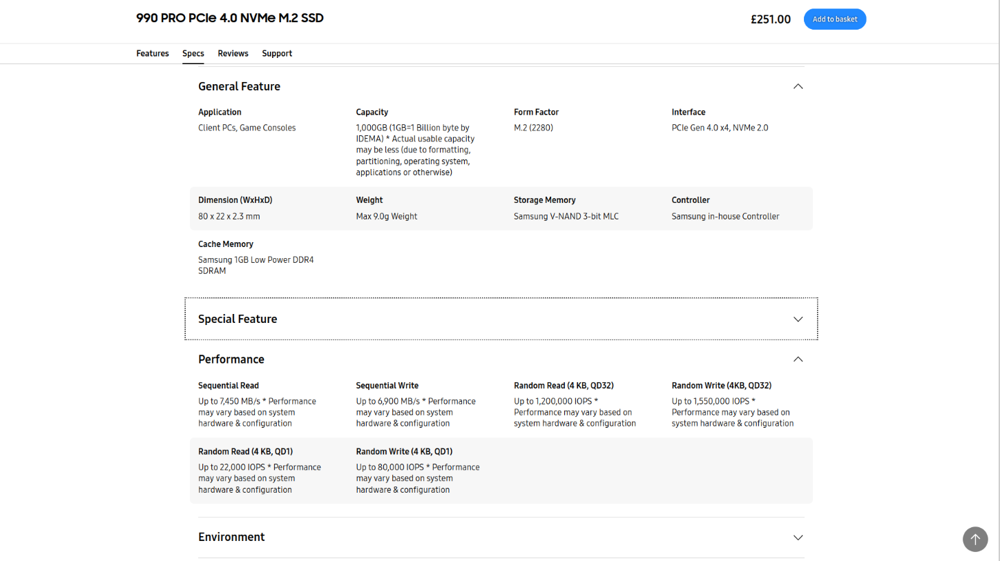
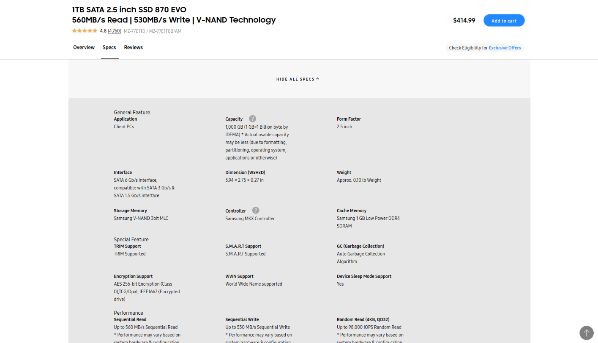
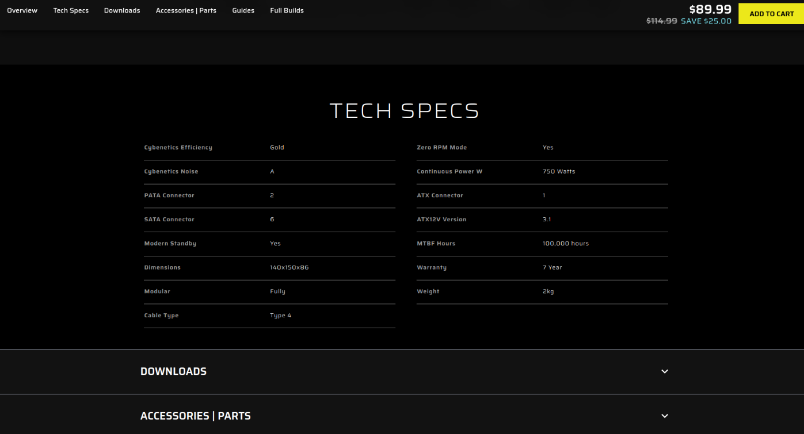
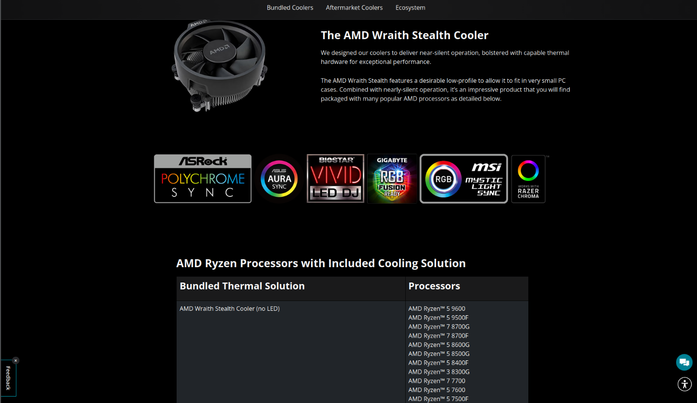

# Lab 3 — Teardown, and the same machine from the command line

Pair: Aisulu S. · Date: 8 November 2026

## Part 1 — The ten parts

Each caption answers three questions in the same order: what the part is, what it plugs into, and what limits it. Every fact was taken from the maker's own page, which is linked under the photo.

### 1. AMD Ryzen 5 7600

A desktop CPU with 6 cores and 12 threads. It runs at 3.8 GHz and boosts up to 5.1 GHz, has 32 MB of L3 cache, a 65 W TDP and a small built-in GPU. It sits in the AM5 socket, and its memory controller works with dual-channel DDR5 only. Limit: it works only on AM5 boards such as the B650, and it can never be paired with DDR4.
Source: https://www.amd.com/en/products/processors/desktops/ryzen/7000-series/amd-ryzen-5-7600.html

### 2. Intel Core i5-13400

A desktop CPU with 10 cores (6 Performance and 4 Efficient) and 16 threads. The P-cores boost up to 4.6 GHz, it has 20 MB of cache, 65 W base power and Intel UHD 730 graphics. It sits in the LGA1700 socket. The memory controller understands both DDR5 (up to 4800 MT/s) and DDR4 (up to 3200 MT/s), but one board has slots for only one of them. Limit: LGA1700 boards only, and the board's slots decide whether the memory is DDR4 or DDR5.
Source: https://www.intel.com/content/www/us/en/products/sku/230495/intel-core-i513400-processor-20m-cache-up-to-4-60-ghz/specifications.html

### 3. ASUS PRIME B650M-A

A micro-ATX motherboard built around the AMD B650 chipset. It provides an AM5 socket, four DDR5 DIMM slots, PCIe 4.0 x4 M.2 slots for NVMe drives and SATA ports, and takes 24-pin and CPU 8-pin power from the PSU. Limit: only AM5 Ryzen processors (the 7000 series and later) and only DDR5 memory. The newest Ryzen generations may need a BIOS update; see the table below.
Source: https://www.asus.com/ru/motherboards-components/motherboards/prime/prime-b650m-a/

### 4. MSI PRO B760M-A WIFI DDR4

A micro-ATX motherboard with the Intel B760 chipset and built-in Wi-Fi. It provides an LGA1700 socket, four DDR4 DIMM slots, M.2 NVMe slots and SATA ports, and takes 24-pin and CPU 8-pin power from the PSU. Limit: only 12th, 13th and 14th generation Intel CPUs on LGA1700, and only DDR4 memory. The word "DDR4" in the name matters, because B760 boards with DDR5 slots also exist.
Source: https://www.msi.com/Motherboard/PRO-B760M-A-WIFI-DDR4

### 5. Kingston FURY Beast DDR5-5600, 16 GB

A 16 GB DDR5 desktop DIMM running at 5600 MT/s, with 288 pins and about 1.25 V. It goes into a DDR5 DIMM slot on the board. Limit: the key notch sits in a different place from DDR4, so it fits only DDR5 slots. Its speed also depends on the CPU and the board: the Ryzen 5 7600 officially lists DDR5-5200, so 5600 is reached through an XMP/EXPO profile.
Source: https://www.kingston.com/en/memory/gaming/kingston-fury-beast-ddr5-memory?speed=5600mt%2Fs&total%20(kit)%20capacity=16gb&kit=single%20module&cas%20latency=40&dram%20density=16gbit&profile%20type=intel%20xmp&color=black

### 6. Crucial DDR4-3200, 16 GB DIMM

A 16 GB DDR4 desktop DIMM at 3200 MT/s, 1.2 V, 288 pins. It goes into a DDR4 DIMM slot. Limit: although the pin count is the same as DDR5, the notch is placed differently, so the module only fits DDR4 slots. 3200 MT/s is also the top DDR4 speed the i5-13400 officially supports.
Source: https://www.crucial.com/memory/ddr4/ct16g4dfra32a

### 7. Samsung 990 PRO 1 TB

A 1 TB NVMe SSD in the M.2 2280 format, PCIe 4.0 x4, with sequential reads of up to about 7,450 MB/s. It is screwed directly into an M.2 slot, no cables required. Limit: it needs an M.2 slot with NVMe/PCIe support, and a PCIe 4.0 x4 slot to reach full speed. This version has no heatsink of its own, so cooling depends on the board's M.2 cover.
Source: https://www.samsung.com/uk/memory-storage/nvme-ssd/990-pro-1tb-nvme-pcie-gen-4-mz-v9p1t0bw/

### 8. Samsung 870 EVO 1 TB

A 1 TB 2.5-inch SATA III (6 Gb/s) SSD with sequential reads of up to about 560 MB/s. It connects to a SATA port on the board with a data cable, gets power from the PSU through a SATA power cable, and needs a 2.5-inch bay or bracket in the case. Limit: the SATA bus tops out around 550 MB/s, which makes it about 13 times slower than the 990 PRO regardless of the flash inside.
Source: https://www.samsung.com/us/memory-storage/sata-ssd/870-evo-sata-2-5-ssd-1tb-sku-mz-77e1t0b-am/

### 9. Corsair RM750e (750 W)

An ATX power supply rated at 750 W, 80 PLUS Gold and fully modular. It powers the board through the 24-pin and CPU 8-pin connectors, the drives through SATA power and, if one is added, a graphics card through PCIe power. Limit: total wattage. A 65 W processor without a graphics card uses far less than 750 W, so in these builds the practical limit is the number of cables and connectors, not the power.
Source: https://www.corsair.com/us/en/p/psu/cp-9020295-na/rme-series-rm750e-fully-modular-low-noise-atx-power-supply-cp-9020295-na#tab-techspecs

### 10. Stock cooler (AMD Wraith Stealth, in the Ryzen 5 7600 box)

The compact air cooler supplied with the Ryzen 5 7600. It attaches to the AM5 mounting holes and takes power from a fan header on the board. Limit: it is designed to remove the heat of a 65 W processor, and it cannot be mounted on an LGA1700 socket, so it is useless for the Intel build. Still to check on intel.com: whether the boxed i5-13400 comes with its own cooler (I believe it does, the Intel Laminar RM1).
Source: https://www.amd.com/en/products/processors/ecosystem/cpu-cooler-solutions.html

---

## The two motherboards compared

| | ASUS PRIME B650M-A | MSI PRO B760M-A WIFI DDR4 |
|---|---|---|
| Socket | AM5 | LGA1700 |
| Chipset | AMD B650 | Intel B760 |
| Form factor | micro-ATX | micro-ATX |
| Memory | DDR5, 4 DIMM slots | DDR4, 4 DIMM slots |
| M.2 slots | 2 | 2 |
| SATA ports | 4 | 4 |
| CPU support | AMD Ryzen 7000 and later, no BIOS update needed | Intel 12th, 13th and 14th generation, no BIOS update needed |

---

## Two builds on paper

How the parts were sorted: first by CPU socket, then by memory type, then by how each SSD connects. Brands played no part.

### Build 1 — AMD platform

| Part | Model | Why it fits here |
|---|---|---|
| Processor | AMD Ryzen 5 7600 | Its AM5 socket leaves the ASUS board as the only choice. |
| Motherboard | ASUS PRIME B650M-A | The AM5 socket matches, and its DDR5 slots agree with the processor's DDR5-only controller. |
| Memory | Kingston FURY Beast DDR5-5600, 16 GB | A DDR5 module for a DDR5 board; a DDR4 module would not fit the notch. |
| SSD | Samsung 990 PRO 1 TB | The NVMe drive plugs straight into the board's PCIe 4.0 M.2 slot and needs no cables. |
| Cooler | AMD Wraith Stealth | It comes in the Ryzen 5 7600 box and mounts on AM5, but not on LGA1700. |

### Build 2 — Intel platform

| Part | Model | Why it fits here |
|---|---|---|
| Processor | Intel Core i5-13400 | Its LGA1700 socket leaves the MSI board as the only choice. |
| Motherboard | MSI PRO B760M-A WIFI DDR4 | The LGA1700 socket matches, and its DDR4 slots work with the i5-13400's DDR4-3200 support. |
| Memory | Crucial DDR4-3200, 16 GB | A DDR4 module for a DDR4 board, running at the i5-13400's official DDR4 maximum. |
| SSD | Samsung 870 EVO 1 TB | The board has SATA ports, so the drive needs only a data cable and a power cable. |
| Power supply | Corsair RM750e | The list has just one PSU and it has to go somewhere. It is placed here because Build 1 already received the cooler; either build could take it, and 750 W is far more than either needs. |

### What each build is still missing

- **Build 1 (AMD):** a power supply (the only one went to Build 2), a case, a monitor, a keyboard and an operating system. A graphics card is not required because the Ryzen 5 7600 has integrated graphics. The 990 PRO needs no cables at all, so there is nothing to buy for the SSD.
- **Build 2 (Intel):** a case with a 2.5-inch drive bay, a SATA data cable (usually included in the motherboard box), a monitor, a keyboard and an operating system. For cooling, it can use the cooler from the i5-13400 box if Intel's page confirms that one ships with it; otherwise it needs a separate LGA1700 cooler.
- **Both:** the ten parts include one PSU and one stock cooler for two computers, and no case, display or peripherals, so neither build can be powered on as listed.

---

## Part 2 — The same facts on different operating systems

| Fact | Windows (PowerShell) | Linux |
|---|---|---|
| CPU model | `Get-CimInstance Win32_Processor \| Select Name` | `lscpu` (field "Model name") |
| Cores / threads | `Get-CimInstance Win32_Processor \| Select NumberOfCores, NumberOfLogicalProcessors` | `lscpu` (fields "Core(s) per socket", "Thread(s) per core", "CPU(s)") |
| Total memory | `Get-CimInstance Win32_PhysicalMemory \| Select Capacity` | `free -h` |
| Memory modules and speed | `Get-CimInstance Win32_PhysicalMemory \| Select DeviceLocator, Capacity, Speed, ConfiguredClockSpeed, SMBIOSMemoryType, FormFactor` | `sudo dmidecode -t memory` |
| Disk model and type | `Get-PhysicalDisk \| Select FriendlyName, MediaType, BusType, Size` | `lsblk -d -o NAME,MODEL,ROTA,TRAN,SIZE` |
| Free space | `Get-Volume C` | `df -h /` |
| Architecture | `$env:PROCESSOR_ARCHITECTURE` | `uname -m` |

Neither of us has a Mac, so there is no macOS column.

### What we noticed

**Names differ between systems.** The same fact is called `NumberOfLogicalProcessors` in PowerShell and `CPU(s)` in `lscpu`. The architecture reads `AMD64` on Windows and `x86_64` on Linux. Windows reports memory size in bytes and gives the memory type as a code (`SMBIOSMemoryType`: 26 is DDR4, 34 is DDR5), while `dmidecode` prints the type and the speed as readable text in MT/s.

**VM versus host.** In the VM, the hypervisor hides the real memory modules, so the memory query returned nothing useful. `lscpu` showed the number of CPUs we assigned to the virtual machine rather than the host's real count, and it contained a "Hypervisor vendor" line. `lsblk` listed a virtual disk instead of the real SSD.

---

## What did not work the first time

- **What i saw:** in the Windows VM, `Get-CimInstance Win32_PhysicalMemory | Select Capacity` printed nothing.
- **What i was:** the hypervisor does not pass the real memory modules through to the guest, so there were no module records to list.
- **What i did:** nothing needed fixing. The command worked as intended; it simply had no data to show in a VM, and we recorded this as a finding instead of a mistake.

---

## Evidence

- [evidence/photos/](evidence/photos/) — the makers' photos or screenshots, one for each of the ten parts.
- [evidence/windows-specs.txt](evidence/windows-specs.txt) — each PowerShell command followed by its raw output.
- [evidence/linux-specs.txt](evidence/linux-specs.txt) — each Linux command followed by its raw output.
