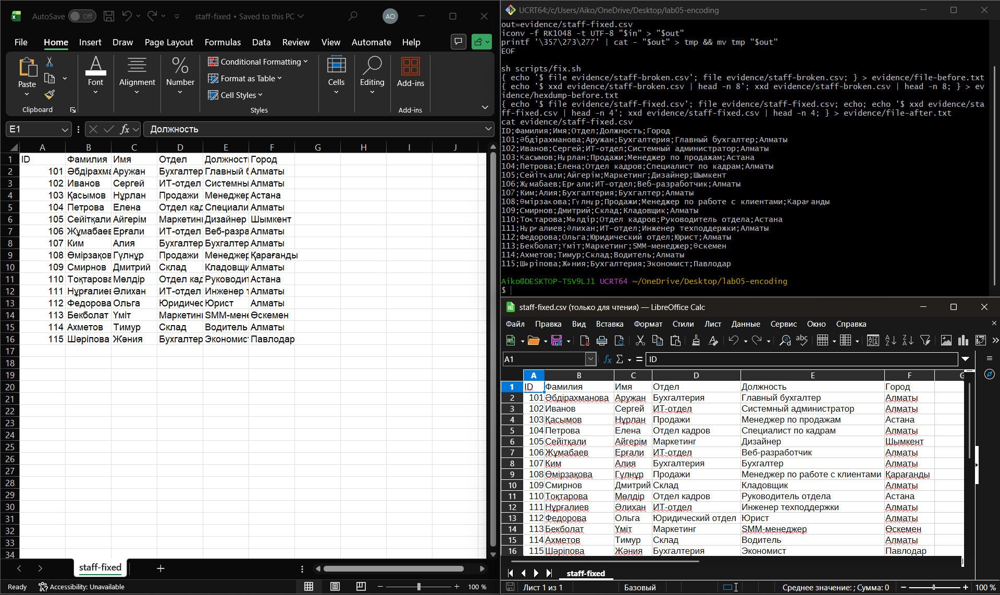

# Lab 5 — Encoding forensics

Name: Aisulu · Date: 16.11.2026 · Tools: Git Bash (file, xxd, iconv), Excel, LibreOffice Calc

## What I received
- **Excel:** standard Russian letters opened fine, but Kazakh-specific letters turned into wrong symbols (for example `"Қ"` appeared as `"Ќ"` and `"Ә"` as `"Ј"`).
- **LibreOffice Calc:** the import dialog defaulted to `Cyrillic (Windows-1251)` with `;` as the separator, and showed the same wrong Kazakh letters as Excel.
- **Terminal (`cat`):** Cyrillic text turned into unreadable replacement blocks, because the terminal expects UTF-8 and the file uses one byte per letter.

## Diagnosis (made before the fix)
- **`file` said:** `Non-ISO extended-ASCII text, with CRLF line terminators` (`evidence/file-before.txt`). So it is a one-byte-per-letter legacy code page, but `file` cannot say which one.
- **First 16 bytes:** `49 44 3b d4 e0 ec e8 eb e8 ff 3b c8 ec ff 3b ce` (`evidence/hexdump-before.txt`).
- **Encoding:** `KZ-1048` (called `RK1048` in `iconv`) — because every Cyrillic letter is a single byte in the range `C0–FF` (e.g. `"А"` in `"Аружан"` is `c0`, `"И"` in `"Имя"` is `c8`, `"Г"` in `"Город"` is `c3`), so it is a code page, not UTF-8 (`D0`/`D1` pairs) or UTF-16 (`xx 04`). `Windows-1251` is ruled out by the first Kazakh name, `"Әбдірахманова"`, which starts with the single byte `a3` (hexdump line `00000020`, offset `0x2a`). In `KZ-1048` `a3` is `"Ә"`, while `Windows-1251` would give `"Ј"`. Decoding the whole file as `RK1048` makes all Russian and Kazakh names read correctly.
- **Line ending:** `CRLF` — because the header row ends with the two bytes `0d 0a` (hexdump line `00000020`, offset `0x24`).
- **BOM:** no — because the file starts directly with `49 44` (`"ID"`), not with `EF BB BF`, `FF FE` or `FE FF`. In the fixed file I added a UTF-8 BOM, because Excel on Windows only recognises UTF-8 on double-click when `EF BB BF` is at the start of the file.
- **Separator:** semicolon `;` (`3b`).

## Fix
Decisions for the fixed file:
- **Encoding:** UTF-8 (the target).
- **BOM:** added (`EF BB BF`) so that Excel opens the file correctly by double-click, as the brief requires.
- **Line ending:** `CRLF` kept, because it is what Excel and Windows users expect.
- **Trade-off:** `CRLF` can break Linux scripts (`$'\r': command not found`, `^M` in `cat -A`). If an `LF` version is ever needed, `sed 's/\r$//'` removes the `\r`. I did not do that here, because the brief requires the file to open correctly in Excel.

`scripts/fix.sh` (run from `labs/lab05-encoding/` with `sh scripts/fix.sh`):

```sh
#!/bin/sh
# Lab 5: staff-broken.csv (KZ-1048 / RK1048, CRLF, no BOM) -> UTF-8 with BOM, CRLF kept
in=evidence/staff-broken.csv
out=evidence/staff-fixed.csv
iconv -f RK1048 -t UTF-8 "$in" > "$out"
printf '\357\273\277' | cat - "$out" > tmp && mv tmp "$out"
```

The original `evidence/staff-broken.csv` is never modified; the script only reads it.

## Verification
- `evidence/file-after.txt`: `file` reports `Unicode text, UTF-8 (with BOM) text, with CRLF line terminators`. The hexdump starts with `ef bb bf 49 44 3b` (BOM, then `"ID;"`) and Cyrillic letters are now two-byte `d0 xx` / `d1 xx` pairs (e.g. `"Ф"` = `d0 a4`).
- `evidence/opens-correctly.png`: Excel (opened by double-click), LibreOffice Calc (Character set `UTF-8`, separator `;`) and Git Bash (`cat`) side by side. All Russian and Kazakh names (`Әбдірахманова`, `Қасымов`, `Нұрлан`, `Жұмабаев`, `Өмірзақова`, …) are correct in all three. In Git Bash a few Kazakh letters look slightly spaced because of the console font; the bytes are correct, as the two spreadsheet views show.



## What did not work the first time
On my first attempt I ran only `iconv -f RK1048 -t UTF-8` without adding a BOM. `cat` in the terminal showed every name correctly, but double-clicking the file in Excel still showed garbage (`Фамилия` instead of `"Фамилия"`), because without `EF BB BF` at the start Excel falls back to a legacy code page. Adding the BOM line to `scripts/fix.sh` fixed it.


## Files
- [scripts/fix.sh](scripts/fix.sh) — conversion script (`RK1048` to `UTF-8` with BOM)
- [evidence/staff-fixed.csv](evidence/staff-fixed.csv) — result of `scripts/fix.sh`
- [evidence/file-before.txt](evidence/file-before.txt) — `file` output before the fix
- [evidence/hexdump-before.txt](evidence/hexdump-before.txt) — first 8 lines of the hex dump before the fix
- [evidence/file-after.txt](evidence/file-after.txt) — `file` and `xxd` output after the fix
- [evidence/opens-correctly.png](evidence/opens-correctly.png) — Excel, LibreOffice Calc and terminal
- [evidence/staff-broken.csv](evidence/staff-broken.csv) — original file, untouched
